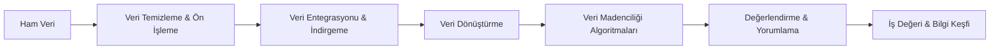

# YBS 301 - Veri Madenciliği

<p align="left">
  
  
  
  
  
  
  
</p>

Bu depo, **Gümüşhane Üniversitesi İktisadi ve İdari Bilimler Fakültesi Yönetim Bilişim Sistemleri Bölümü** bünyesinde yürütülen **YBS 301 Veri Madenciliği** dersine ait haftalık ders sunumlarını, teorik çalışma notlarını, adım adım laboratuvar uygulama rehberlerini, etkileşimli Jupyter Notebook'larını ve gerçek dünya uygulama veri setlerini içermektedir.

---

## 📌 Ders Bilgileri

| Alan | Bilgi |
| :--- | :--- |
| **Kurum** | Gümüşhane Üniversitesi |
| **Fakülte / Bölüm** | İktisadi ve İdari Bilimler Fakültesi / Yönetim Bilişim Sistemleri (YBS) |
| **Ders Kodu & Adı** | YBS 301 - Veri Madenciliği |
| **Dönem** | 2026-2027 Güz Yarıyılı |
| **Ders Sorumlusu** | Dr. Kahraman Koştaş |
| **Ders Günü & Laboratuvar** | Çarşamba / LAB 2 |
| **Görüşme / Ofis Saatleri** | Çarşamba (Tüm gün) |

---

## 🎯 Dersin Amacı ve Kapsamı

Bu dersin temel amacı; öğrencilere modern veri madenciliği kavram ve prensiplerini öğretmek, ham veriden değer üretme sürecinin (**Bilgi Keşfi - KDD**) tüm aşamalarını aktarmak ve öğrencilerin iş/yönetim dünyasındaki problemlere uygun veri madenciliği algoritmalarını seçip Python ekosistemiyle başarıyla uygulayabilmelerini sağlamaktır.



### Temel Öğrenme Hedefleri
* 💡 **Kavramsal Yetkinlik:** Veri madenciliğinin teorik temellerini, veri tiplerini, ölçek türlerini ve makine öğrenmesi yaklaşımlarını kavrama.
* 🧹 **Veri Hazırlama & Ön İşleme:** Eksik, gürültülü ve tutarsız verileri tespit etme; şema ve varlık eşleme ile çoklu kaynakları entegre etme; normalizasyon ve veri küpü (*roll-up*) oluşturma.
* 📊 **Keşifsel Veri Analizi (EDA):** Veri setlerinin yapısal özelliklerini, korelasyonlarını ve istatistiksel dağılımlarını görselleştirerek anlama.
* 🤖 **Uygulamalı Modelleme:** Sınıflandırma, kümeleme ve birliktelik kuralları algoritmalarını gerçek vaka senaryoları üzerinde çalıştırma.

---

## 📅 Haftalık Müfredat ve Ders Materyalleri

Aşağıdaki tablodan ilgili haftaya tıklayarak sunumlara, çalışma notlarına, veri setlerine ve uygulamalı defterlere erişebilirsiniz:

| Hafta | Konu / Uygulama | Ders Sunumu | Çalışma Notları | Lab / Uygulama Materyalleri | Durum |
| :---: | :--- | :---: | :---: | :---: | :---: |
| 🐍 **Pratik** | [Python, NumPy ve Pandas Pratik Alanı](pratik/readme.md) | 🎬 [Video Eğitimi](https://www.youtube.com/watch?v=_wZUNiGtkcw) | 📓 [NumPy Notları](pratik/01_numpy.ipynb) | 📓 [Pandas Notebook](pratik/02_pandas.ipynb) | ✅ Aktif |
| **01** | [Veri Setlerini Tanıma ve Keşifsel Veri Analizi (EDA)](hafta1/README.md) | 📑 [ders1.pptx](hafta1/ders1.pptx) | 📖 [1. Hafta Notları](hafta1/YBS301_Veri_Madenciligi_Calisma_Notlari_Hafta1.md) | 📖 [1. Hafta EDA Rehberi](hafta1/README.md) *(7 Temel Veri Seti)* | ✅ Tamamlandı |
| **02** | [Veri Hazırlama ve Ön İşleme: Teori ve Vaka Tasarımı](hafta2/README.md) | 📑 [2.pptx](hafta2/2.pptx) | 📖 [2. Hafta Notları](hafta2/YBS301_Veri_Madenciligi_Calisma_Notlari_Hafta2.md) | 🖼️ [Süreç Şeması](hafta2/Veri_Hazırlama.jpg) / 📁 [Vaka Veri Seti](hafta2/gumushane_pestil_kome_veriseti/readme.md) | ✅ Tamamlandı |
| **03** | [Veri Hazırlama ve Ön İşleme: Adım Adım Laboratuvar Uygulaması](hafta3/README.md) | 📑 [2.pptx](hafta3/2.pptx) | 📖 [Vaka Kılavuzu](hafta3/gumushane_pestil_kome_veriseti/readme.md) | 📓 [Uygulama Defteri](hafta3/gumushane_pestil_kome_veriseti/gumushane_veri_hazirlama_uygulamasi.ipynb) / 📦 [hafta3.zip](hafta3/hafta3.zip) | ✅ Aktif |
| **04** | Birliktelik Kuralları Madenciliği (Association Rules & Apriori) | — | — | ⏳ *Gelecek Hafta* | 🔄 Planlandı |
| **05** | Sınıflandırma: Karar Ağaçları (Decision Trees - ID3, C4.5, CART) | — | — | ⏳ *Gelecek Hafta* | 🔄 Planlandı |
| **06** | Sınıflandırma: Olasılıksal & Örnek Tabanlı (Naive Bayes & k-NN) | — | — | ⏳ *Gelecek Hafta* | 🔄 Planlandı |
| **07** | Sınıflandırma: Lojistik Regresyon & Destek Vektör Makineleri (SVM) | — | — | ⏳ *Gelecek Hafta* | 🔄 Planlandı |
| **08** | 📝 **Ara Sınav (Vize Sınavı)** | — | — | 📝 *Sınav Dönemi* | ⏳ Sınav |
| **09** | Kümeleme Analizi: K-Ortalamalar (K-Means) ve Hiyerarşik Kümeleme | — | — | ⏳ *Gelecek Hafta* | 🔄 Planlandı |
| **10** | Yoğunluk Tabanlı Kümeleme (DBSCAN) ve Aykırı Değer (Anomali) Analizi | — | — | ⏳ *Gelecek Hafta* | 🔄 Planlandı |
| **11** | Boyut İndirgeme ve Öznitelik Seçimi: Temel Bileşenler Analizi (PCA) | — | — | ⏳ *Gelecek Hafta* | 🔄 Planlandı |
| **12** | Model Başarımı ve Değerlendirme (Confusion Matrix, ROC-AUC, K-Fold CV) | — | — | ⏳ *Gelecek Hafta* | 🔄 Planlandı |
| **13** | Topluluk Öğrenmesi (Ensemble Learning: Random Forest, Boosting) | — | — | ⏳ *Gelecek Hafta* | 🔄 Planlandı |
| **14** | 🚀 **Dönem Sonu Proje Sunumları ve Vaka İncelemeleri** | — | — | 🎯 *Final Değerlendirme* | ⏳ Proje |

---

## 📁 Depo Dizin Yapısı

```text
YBS-DataMining/
├── hafta1/                            # 1. Hafta: Veri Setlerini Tanıma & EDA
│   ├── README.md                      # 1. Hafta Laboratuvar Notları ve EDA Rehberi
│   ├── YBS301_Veri_Madenciligi_Calisma_Notlari_Hafta1.md # Kapsamlı Çalışma Notları
│   └── ders1.pptx                     # 1. Hafta Teorik Ders Sunumu
├── hafta2/                            # 2. Hafta: Veri Hazırlama & Ön İşleme Teorisi
│   ├── README.md                      # 2. Hafta Laboratuvar ve Süreç Rehberi
│   ├── YBS301_Veri_Madenciligi_Calisma_Notlari_Hafta2.md # Detaylı Çalışma Notları
│   ├── 2.pptx                         # 2. Hafta Teorik Ders Sunumu
│   ├── Veri_Hazırlama.jpg             # Veri Hazırlama Süreç Mimarisi Şeması
│   ├── Veri_Hazırlama_ve_Değişken_Tipleri.jpg # Değişken Tipleri ve Ölçek Şeması
│   └── gumushane_pestil_kome_veriseti/ # Ham Veri Seti Dosyaları ve Vaka Senaryosu
│       ├── A_dukkan_kasa_satislari.csv
│       ├── B_eticaret_siparisleri.xlsx
│       ├── C_uretici_kayitlari.csv
│       ├── D_ilce_referans_tablosu.csv
│       └── readme.md                  # Vaka Senaryosu ve Öğrenci Görevleri
├── hafta3/                            # 3. Hafta: Veri Hazırlama Adım Adım Laboratuvarı
│   ├── README.md                      # 3. Hafta Laboratuvar Yönergesi ve Adımları
│   ├── 2.pptx                         # 3. Hafta Giriş ve Hatırlatma Sunumu
│   ├── hafta3.zip                     # Tüm 3. Hafta Dosyaları ve Veri Seti Arşivi
│   ├── gumushane_pestil_kome_veriseti/ # Uygulama Klasörü
│   │   ├── gumushane_veri_hazirlama_uygulamasi.ipynb # Çözümlü Uygulama Notebook'u
│   │   ├── A_dukkan_kasa_satislari.csv
│   │   ├── B_eticaret_siparisleri.xlsx
│   │   ├── C_uretici_kayitlari.csv
│   │   ├── D_ilce_referans_tablosu.csv
│   │   └── readme.md                  # Senaryo ve Görev Dokümanı
│   └── pratik/                        # Hafta 3 Pratik ve Yardımcı Notebook'ları
├── pratik/                            # Python & Analitik Temel Pratik Alanı
│   ├── readme.md                      # Python, NumPy ve Pandas Pratik Rehberi
│   ├── 01_numpy.ipynb                 # NumPy Uygulama ve Alıştırma Defteri
│   └── 02_pandas.ipynb                # Pandas Veri Manipülasyon Defteri
└── readme.md                          # Ana Depo Bilgilendirme Sayfası
```

---

## 💻 Çalışma Ortamı Kurulumu

Ders materyallerini iki farklı ortamda çalıştırabilirsiniz:

### Seçenek 1: Google Colab (Kurulum Gerektirmez)
1. İlgili haftadaki `.ipynb` uzantılı notebook dosyasını veya sıkıştırılmış arşiv dosyasını (`hafta3.zip`) bilgisayarınıza indirin.
2. [Google Colab](https://colab.research.google.com/) adresine gidin ve dosyayı yükleyin.
3. Herhangi bir yerel kütüphane kurulumuna gerek kalmadan doğrudan tarayıcınızda kodları çalıştırabilirsiniz.

### Seçenek 2: Yerel Geliştirme Ortamı (VS Code / Jupyter Lab)
1. **Depoyu Klonlayın:**
   ```bash
   git clone https://github.com/kahramankostas/YBS-DataMining.git
   cd YBS-DataMining
   ```

2. **Gerekli Python Kütüphanelerini Kurun:**
   ```bash
   pip install pandas numpy matplotlib seaborn scikit-learn openpyxl pyarrow jupyter
   ```

3. **Jupyter Lab veya VS Code Başlatın:**
   ```bash
   jupyter lab
   ```

> [!TIP]
> Notebook hücrelerini sırasıyla çalıştırmak için **`Shift + Enter`** kısayolunu kullanabilirsiniz. Kod bloklarının yanındaki ✍️ "Sıra Sende" bölümlerini bağımsız olarak tamamlamanız önerilir.

---

## 📚 Kaynaklar ve Önerilen Okumalar

* 📖 **Jiawei Han, Micheline Kamber, Jian Pei** — *Data Mining: Concepts and Techniques (3rd Edition)*, Morgan Kaufmann.
* 📖 **Pang-Ning Tan, Michael Steinbach, Anuj Karpatne, Vipin Kumar** — *Introduction to Data Mining (2nd Edition)*, Pearson.
* 📖 **Wes McKinney** — *Python for Data Analysis: Data Wrangling with Pandas, NumPy, and Jupyter (3rd Edition)*, O'Reilly.
* 🌐 [Scikit-Learn Resmi Dokümantasyonu](https://scikit-learn.org/stable/)
* 🌐 [Pandas Resmi Kullanıcı Kılavuzu](https://pandas.pydata.org/docs/user_guide/index.html)

---

## 📬 İletişim

* **Ders Sorumlusu:** Dr. Kahraman Koştaş
* **Bölüm:** Yönetim Bilişim Sistemleri (YBS), İktisadi ve İdari Bilimler Fakültesi
* **Kurum:** Gümüşhane Üniversitesi
* **E-posta:** kahramankostas@gumushane.edu.tr
* **Ders Görüşme:** Çarşamba (Ders ve Lab saatleri sonrası)