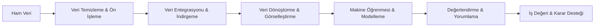

# YBS 301 - Veri Madenciliği

<p align="left">
  
  
  
  
  
  
  
  
  
</p>

Bu depo, **Gümüşhane Üniversitesi İktisadi ve İdari Bilimler Fakültesi Yönetim Bilişim Sistemleri Bölümü** bünyesinde yürütülen **YBS 301 Veri Madenciliği** dersine ait haftalık ders sunumlarını, teorik çalışma notlarını, etkileşimli görselleştirme/öğrenme araçlarını, adım adım laboratuvar uygulama rehberlerini, Jupyter Notebook'larını, vize çalışma sorularını, dönem projesi yönergelerini ve gerçek dünya uygulama veri setlerini içermektedir.

> 🌐 **Ders Web Sayfası:** [`index.html`](index.html) *(GitHub Pages: `https://kahramankostas.github.io/YBS-DataMining/`)*

---

## 📌 Ders Bilgileri

| Alan | Bilgi |
| :--- | :--- |
| **Kurum** | Gümüşhane Üniversitesi |
| **Fakülte / Bölüm** | İktisadi ve İdari Bilimler Fakültesi / Yönetim Bilişim Sistemleri (YBS) |
| **Ders Kodu & Adı** | YBS 301 - Veri Madenciliği |
| **Dönem** | 2026-2027 Güz Yarıyılı |
| **Ders Sorumlusu** | Dr. Kahraman Koştaş |
| **Ders Günü & Laboratuvar** | Çarşamba / LAB 2 |
| **Görüşme / Ofis Saatleri** | Çarşamba (Ders ve Lab saatleri sonrası) |

---

## 🎯 Dersin Amacı ve Kapsamı

Bu dersin temel amacı; öğrencilere modern veri madenciliği kavram ve prensiplerini öğretmek, ham veriden değer üretme sürecinin (**Bilgi Keşfi - KDD**) tüm aşamalarını aktarmak ve öğrencilerin iş/yönetim dünyasındaki problemlere uygun veri madenciliği algoritmalarını seçip Python ekosistemiyle (**NumPy, pandas, Matplotlib, scikit-learn**) başarıyla uygulayabilmelerini sağlamaktır.



### Temel Öğrenme Hedefleri
* 💡 **Kavramsal Yetkinlik:** Veri madenciliğinin teorik temellerini, DIKW piramidini, veri tiplerini, ölçek türlerini ve makine öğrenmesi yaklaşımlarını kavrama.
* 🧹 **Veri Hazırlama & Ön İşleme:** Eksik, gürültülü ve tutarsız verileri tespit etme; şema ve varlık eşleme ile çoklu kaynakları entegre etme; normalizasyon ve veri küpü (*roll-up*) oluşturma.
* 📊 **Keşifsel Veri Analizi (EDA) & Görselleştirme:** Veri setlerinin yapısal özelliklerini, korelasyonlarını ve istatistiksel dağılımlarını Matplotlib ve pandas ile grafikleştirerek yorumlama.
* 🤖 **Uygulamalı Modelleme:** scikit-learn API'si ile sınıflandırma, regresyon ve kümeleme algoritmalarını gerçek vaka senaryoları üzerinde eğitme, test etme ve değerlendirme.

---

## 🚀 Öne Çıkan Modüller: Dönem Projesi & Vize Hazırlık

| Modül | Açıklama | Bağlantı |
| :--- | :--- | :---: |
| 🎓 **Dönem Projesi** | 4–5 kişilik ekipler halinde, 12 farklı gerçek dünya iş problemi ve veri seti üzerinden uçtan uca veri madenciliği ve makine öğrenmesi projesi. | 📄 [Proje Yönergesi](odev/Veri%20Madencili%C4%9Fi%20D%C3%B6nem%20Projesi.md) |
| 📝 **Vize Çalışma Soruları** | Hafta 1-2 teorik konuları ile NumPy, pandas ve Matplotlib uygulamalarını kapsayan **245 soruluk** (çoktan seçmeli, boşluk doldurma, doğru/yanlış, kod çıktısı) çözümlü çalışma seti. | 📖 [Markdown](vize/YBS301%20Veri%20Madencili%C4%9Fi%20%E2%80%93%20%C3%87al%C4%B1%C5%9Fma%20Sorular%C4%B1.md) / 📄 [PDF](vize/YBS301%20Veri%20Madencili%C4%9Fi%20%E2%80%93%20%C3%87al%C4%B1%C5%9Fma%20Sorular%C4%B1.pdf) |

---

## 📅 Haftalık Müfredat ve Ders Materyalleri

Aşağıdaki tablodan ilgili haftaya tıklayarak sunumlara, çalışma notlarına, veri setlerine ve uygulamalı defterlere erişebilirsiniz:

| Hafta | Konu / Uygulama | Ders Sunumu | Çalışma Notları | Lab / Uygulama Materyalleri | Durum |
| :---: | :--- | :---: | :---: | :---: | :---: |
| 🐍 **Pratik** | [Python, NumPy ve Pandas Pratik Alanı](pratik/readme.md) | 🎬 [Video Eğitimi](https://www.youtube.com/watch?v=_wZUNiGtkcw) | 📓 [NumPy Notları](pratik/01_numpy.ipynb) | 📓 [Pandas Notebook](pratik/02_pandas.ipynb) | ✅ Aktif |
| **01** | [Veri Setlerini Tanıma ve Keşifsel Veri Analizi (EDA)](hafta1/README.md) | 📑 [ders1.pptx](hafta1/ders1.pptx) | 📖 [1. Hafta Notları](hafta1/YBS301_Veri_Madenciligi_Calisma_Notlari_Hafta1.md) | 📖 [EDA Rehberi](hafta1/README.md) *(7 Temel Veri Seti)* | ✅ Tamamlandı |
| **02** | [Veri Hazırlama ve Ön İşleme: Teori ve Vaka Tasarımı](hafta2/README.md) | 📑 [2.pptx](hafta2/2.pptx) | 📖 [2. Hafta Notları](hafta2/YBS301_Veri_Madenciligi_Calisma_Notlari_Hafta2.md) | 🖼️ [Süreç Şeması](hafta2/Veri_Hazirlama.jpg) / 📁 [Vaka Veri Seti](hafta2/gumushane_pestil_kome_veriseti/readme.md) | ✅ Tamamlandı |
| **03** | [Veri Hazırlama ve Ön İşleme: Adım Adım Laboratuvar Uygulaması](hafta3/README.md) | 📑 [3.pptx](hafta3/3.pptx) | 📖 [Vaka Kılavuzu](hafta3/gumushane_pestil_kome_veriseti/readme.md) | 📓 [Uygulama Defteri](hafta3/gumushane_pestil_kome_veriseti/gumushane_veri_hazirlama_uygulamasi.ipynb) | ✅ Tamamlandı |
| **04** | [pandas ile Veri Manipülasyonu ve Matplotlib Görselleştirme](hafta4/README.md) | 📑 [4.pptx](hafta4/4.pptx) | 📓 [02_pandas.ipynb](hafta4/02_pandas.ipynb) | 📓 [03_matplotlib.ipynb](hafta4/03_matplotlib.ipynb) / 📁 [Veri Seti](hafta4/gumushane_pestil_kome_veriseti/readme.md) | ✅ Tamamlandı |
| **05–06** | Birliktelik Kuralları & Sınıflandırma Temelleri | — | — | ⏳ *Sınıf İçi Uygulamalar* | ✅ Tamamlandı |
| **07** | [Matplotlib ile Veri Görselleştirme & scikit-learn ile Makine Öğrenmesi](hafta7/README.md) | 📑 [Matplotlib](hafta7/Matplotlib_Veri_Gorsellestirme.pptx) / 📑 [scikit-learn](hafta7/scikit-learn_Makine_Ogrenmesi.pptx) | 📓 [03_matplotlib.ipynb](hafta7/03_matplotlib.ipynb) | 📓 [04_scikit_learn.ipynb](hafta7/04_scikit_learn.ipynb) | ✅ Tamamlandı |
| 📝 **Vize** | [YBS301 Veri Madenciliği Vize Çalışma Soruları](vize/YBS301%20Veri%20Madencili%C4%9Fi%20%E2%80%93%20%C3%87al%C4%B1%C5%9Fma%20Sorular%C4%B1.md) | — | 📖 [245 Çözümlü Soru (MD)](vize/YBS301%20Veri%20Madencili%C4%9Fi%20%E2%80%93%20%C3%87al%C4%B1%C5%9Fma%20Sorular%C4%B1.md) | 📄 [PDF Versiyonu](vize/YBS301%20Veri%20Madencili%C4%9Fi%20%E2%80%93%20%C3%87al%C4%B1%C5%9Fma%20Sorular%C4%B1.pdf) | ✅ Tamamlandı |
| **08** | 📝 **Ara Sınav (Vize) Haftası** | — | — | 🎯 *Değerlendirme Dönemi* | ✅ Tamamlandı |
| **09** | [Makine Öğrenmesi Algoritmaları, Değerlendirme Metrikleri & Etkileşimli Oyun Alanı](hafta9/README.md) | 📑 [ML Partisi](hafta9/ML_Algoritmalari_Tanisma_Partisi.pptx) / 📑 [scikit-learn](hafta9/scikit-learn_Makine_Ogrenmesi.pptx) | 📄 [Metrikler PDF](hafta9/BasiteAccuracyPrecisionRecallveF1Score.pdf) / 🎮 [Animasyonlu Metrikler](hafta9/Accuracy_Precision_Recall_F1_Animasyonlu.html) | 📓 [04_scikit_learn.ipynb](hafta9/04_scikit_learn.ipynb) / 🕹️ [ML Oyun Alanı](hafta9/ML_Oyun_Alani.html) | ✅ Aktif |
| 🎓 **Ödev** | [Veri Madenciliği Dönem Projesi](odev/Veri%20Madencili%C4%9Fi%20D%C3%B6nem%20Projesi.md) | — | 📋 [Proje Şartnamesi](odev/Veri%20Madencili%C4%9Fi%20D%C3%B6nem%20Projesi.md) | 📊 12 Farklı Vaka & Veri Seti Havuzu | ⏳ 20 Aralık 2026 |
| **10** | Kümeleme Analizi: K-Ortalamalar (K-Means) ve Hiyerarşik Kümeleme | — | — | ⏳ *Planlandı* | 🔄 Planlandı |
| **11** | Boyut İndirgeme ve Temel Bileşenler Analizi (PCA) | — | — | ⏳ *Planlandı* | 🔄 Planlandı |
| **12** | Topluluk Öğrenmesi (Ensemble Learning: Random Forest, Gradient Boosting) | — | — | ⏳ *Planlandı* | 🔄 Planlandı |
| **13–14**| 🚀 **Dönem Sonu Proje Sunumları ve Vaka Savunmaları** | — | — | 🎯 *Final Değerlendirmesi (23 Aralık 2026)* | ⏳ Proje |

---

## 📁 Depo Dizin Yapısı

```text
YBS-DataMining/
├── hafta1/                            # 1. Hafta: Veri Setlerini Tanıma & EDA
│   ├── README.md                      # 1. Hafta Laboratuvar Notları ve EDA Rehberi
│   ├── YBS301_Veri_Madenciligi_Calisma_Notlari_Hafta1.md # Kapsamlı Çalışma Notları
│   └── ders1.pptx                     # 1. Hafta Teorik Ders Sunumu
├── hafta2/                            # 2. Hafta: Veri Hazırlama & Ön İşleme Teorisi
│   ├── README.md                      # 2. Hafta Laboratuvar ve Süreç Rehberi
│   ├── YBS301_Veri_Madenciligi_Calisma_Notlari_Hafta2.md # Detaylı Çalışma Notları
│   ├── 2.pptx                         # 2. Hafta Teorik Ders Sunumu
│   ├── Veri_Hazirlama.jpg             # Veri Hazırlama Süreç Mimarisi Şeması
│   ├── Veri_Hazirlama_ve_Degisken_Tipleri.jpg # Değişken Tipleri ve Ölçek Şeması
│   └── gumushane_pestil_kome_veriseti/ # Ham Veri Seti Dosyaları ve Vaka Senaryosu
│       ├── A_dukkan_kasa_satislari.csv
│       ├── B_eticaret_siparisleri.xlsx
│       ├── C_uretici_kayitlari.csv
│       ├── D_ilce_referans_tablosu.csv
│       └── readme.md                  # Vaka Senaryosu ve Öğrenci Görevleri
├── hafta3/                            # 3. Hafta: Veri Hazırlama Adım Adım Laboratuvarı
│   ├── README.md                      # 3. Hafta Laboratuvar Yönergesi ve Adımları
│   ├── 3.pptx                         # 3. Hafta Giriş ve Hatırlatma Sunumu
│   ├── gumushane_pestil_kome_veriseti/ # Uygulama Klasörü
│   │   ├── gumushane_veri_hazirlama_uygulamasi.ipynb # Çözümlü Uygulama Notebook'u
│   │   ├── A_dukkan_kasa_satislari.csv
│   │   ├── B_eticaret_siparisleri.xlsx
│   │   ├── C_uretici_kayitlari.csv
│   │   ├── D_ilce_referans_tablosu.csv
│   │   └── readme.md                  # Senaryo ve Görev Dokümanı
│   └── pratik/                        # Hafta 3 Pratik ve Yardımcı Notebook'ları
├── hafta4/                            # 4. Hafta: pandas & Matplotlib Uygulamaları
│   ├── README.md                      # 4. Hafta Laboratuvar Yönergesi
│   ├── 4.pptx                         # 4. Hafta Ders Sunumu
│   ├── 02_pandas.ipynb                # pandas ile Veri Analizi ve Ön İşleme
│   ├── 03_matplotlib.ipynb            # Matplotlib ile Veri Görselleştirme
│   └── gumushane_pestil_kome_veriseti/ # Uygulama Veri Seti ve Notebook
├── hafta7/                            # 7. Hafta: Görselleştirme & scikit-learn
│   ├── README.md                      # 7. Hafta Yönergesi
│   ├── Matplotlib_Veri_Gorsellestirme.pptx # Matplotlib Sunumu ("Doğru Soruya Doğru Grafik")
│   ├── scikit-learn_Makine_Ogrenmesi.pptx  # scikit-learn Sunumu ("Bir API Öğren, Hepsini Kullan")
│   ├── 03_matplotlib.ipynb            # Matplotlib Uygulamalı Notebook
│   ├── 04_scikit_learn.ipynb          # scikit-learn Makine Öğrenmesi Notebook
│   └── ziyaretci.png                  # Örnek Çıktı Görseli
├── hafta9/                            # 9. Hafta: ML Algoritmaları, Metrikler & Etkileşimli Araçlar
│   ├── README.md                      # 9. Hafta Yönergesi
│   ├── ML_Algoritmalari_Tanisma_Partisi.pptx # ML Algoritmaları Sunumu
│   ├── scikit-learn_Makine_Ogrenmesi.pptx  # scikit-learn Makine Öğrenmesi Sunumu
│   ├── 04_scikit_learn.ipynb          # scikit-learn Uygulama Notebook'u
│   ├── BasiteAccuracyPrecisionRecallveF1Score.pdf # Metrikler Özet PDF
│   ├── Accuracy_Precision_Recall_F1_Animasyonlu.html # Animasyonlu Metrikler Aracı
│   └── ML_Oyun_Alani.html             # Etkileşimli ML Oyun Alanı
├── odev/                              # Dönem Projesi ve Görev Tanımları
│   └── Veri Madenciliği Dönem Projesi.md # Kapsamlı Proje Yönergesi, Kriterler ve Konu Havuzu
├── pratik/                            # Temel Programlama ve Analitik Pratik Alanı
│   ├── readme.md                      # Video ve Notebook Çalışma Rehberi
│   ├── 01_numpy.ipynb                 # NumPy ile Sayısal Hesaplama Notebook'u
│   └── 02_pandas.ipynb                # pandas ile Veri Analizi Notebook'u
├── vize/                              # Sınav Hazırlık Materyalleri
│   ├── YBS301 Veri Madenciliği – Çalışma Soruları.md  # 245 Çözümlü Çalışma Sorusu (Markdown)
│   └── YBS301 Veri Madenciliği – Çalışma Soruları.pdf # 245 Çözümlü Çalışma Sorusu (PDF)
├── index.html                         # Dersin Resmi GitHub Pages Web Sayfası
├── moodle_sablonlari.html             # Moodle İçin Hazır HTML Aktivite Kartları
└── readme.md                          # Ana Depo Bilgilendirme Sayfası
```

---

## 💻 Çalışma Ortamı Kurulumu

Ders materyallerini iki farklı ortamda çalıştırabilirsiniz:

### Seçenek 1: Google Colab (Kurulum Gerektirmez)
1. İlgili haftadaki `.ipynb` uzantılı notebook dosyasını bilgisayarınıza indirin.
2. [Google Colab](https://colab.research.google.com/) adresine gidin ve dosyayı yükleyin.
3. Herhangi bir yerel kütüphane kurulumuna gerek kalmadan doğrudan tarayıcınızda kodları çalıştırabilirsiniz.

### Seçenek 2: Yerel Geliştirme Ortamı (VS Code / Jupyter Lab)
1. **Depoyu Klonlayın:**
   ```bash
   git clone https://github.com/kahramankostas/YBS-DataMining.git
   cd YBS-DataMining
   ```

2. **Gerekli Python Kütüphanelerini Kurun:**
   ```bash
   pip install pandas numpy matplotlib seaborn scikit-learn openpyxl pyarrow jupyter
   ```

3. **Jupyter Lab veya VS Code Başlatın:**
   ```bash
   jupyter lab
   ```

> [!TIP]
> Notebook hücrelerini sırasıyla çalıştırmak için **`Shift + Enter`** kısayolunu kullanabilirsiniz. Kod bloklarının yanındaki ✍️ "Sıra Sende / Alıştırma" bölümlerini bağımsız olarak tamamlamanız önerilir.

---

## 📚 Kaynaklar ve Önerilen Okumalar

* 📖 **Jiawei Han, Micheline Kamber, Jian Pei** — *Data Mining: Concepts and Techniques (3rd Edition)*, Morgan Kaufmann.
* 📖 **Pang-Ning Tan, Michael Steinbach, Anuj Karpatne, Vipin Kumar** — *Introduction to Data Mining (2nd Edition)*, Pearson.
* 📖 **Wes McKinney** — *Python for Data Analysis: Data Wrangling with Pandas, NumPy, and Jupyter (3rd Edition)*, O'Reilly.
* 🌐 [Scikit-Learn Resmi Dokümantasyonu](https://scikit-learn.org/stable/)
* 🌐 [Pandas Resmi Kullanıcı Kılavuzu](https://pandas.pydata.org/docs/user_guide/index.html)
* 🌐 [Matplotlib Dokümantasyonu ve Örnek Galerisi](https://matplotlib.org/stable/gallery/index.html)

---

## 📬 İletişim

* **Ders Sorumlusu:** Dr. Kahraman Koştaş
* **Bölüm:** Yönetim Bilişim Sistemleri (YBS), İktisadi ve İdari Bilimler Fakültesi
* **Kurum:** Gümüşhane Üniversitesi
* **E-posta:** kahramankostas@gumushane.edu.tr
* **Ders Görüşme:** Çarşamba (Ders ve Lab saatleri sonrası)
